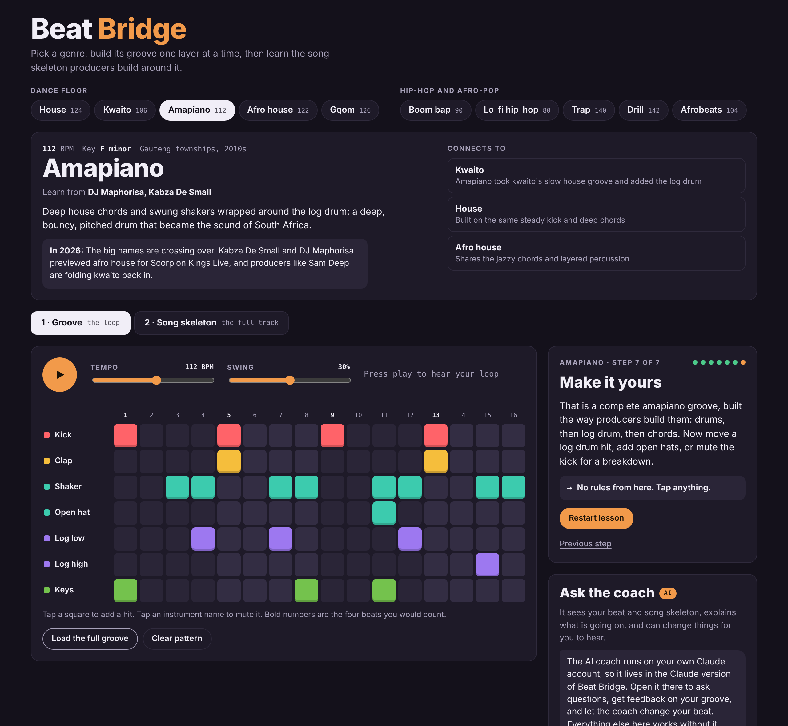
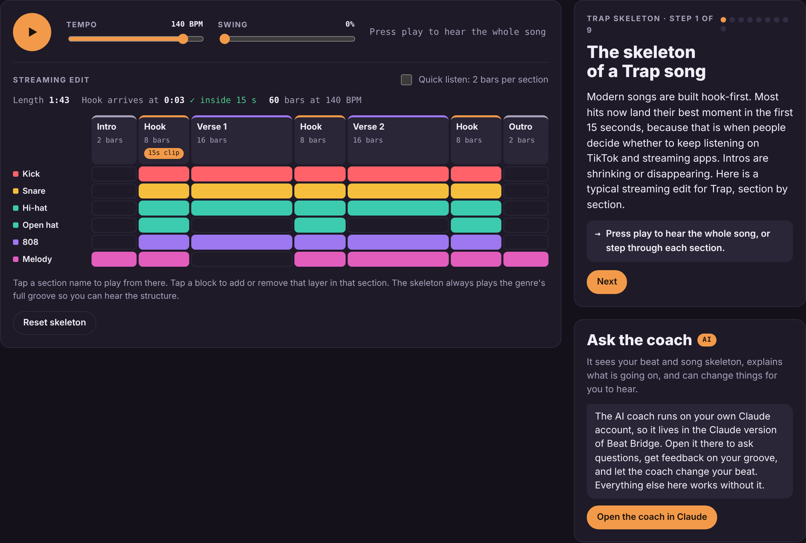

# Beat Bridge

**Learn to make beats in 10 genres, right in your browser.** Build a genre's groove one layer at a time, then learn the song skeleton producers build around it, from amapiano and gqom to trap, drill and boom bap.

**[Live demo](https://YOUR-USERNAME.github.io/beat-bridge/)** · Works on phones · Works offline · No sign-up



## Why I built it

Lots of people love music and want to make beats but don't know where to start. Most tools either break songs down or let you make music, and few teach you how to get from one to the other. Beat Bridge teaches the building blocks of each genre through the techniques of the producers who shaped it, and it's built to be light on data for South African users.

## Features

- **10 genres** in two families: house, kwaito, amapiano, afro house and gqom, then boom bap, lo-fi, trap, drill and afrobeats. Each has its own sound kit, tempo, key and four-bar chord loop.
- **Guided groove lessons.** 5 to 7 steps per genre, each teaching a signature technique: the amapiano log drum, gqom's broken kick, afrobeats' 3-3-2 rhythm, trap hi-hat rolls, the "Dilla feel" swing. The squares to tap next glow, and the next step unlocks once the pattern is right.
- **Song skeleton view.** A timeline of each genre's full song structure (intro, hook, verse, breakdown, build, outro) that you can play and edit. A live check shows whether the hook arrives within the first 15 seconds, the standard for streaming and short-video apps. Club genres also include a DJ extended mix to compare.
- **Genre family tree.** Each genre links to related ones and explains the connection, for example kwaito leading to amapiano.
- **AI coach.** In the Claude-hosted version, a coach reads your current pattern and song structure, gives feedback, and can edit the beat for you to hear, with one-click undo.
- **Installable and offline.** Add it to your home screen, and it keeps working without data after the first visit.



## How it works

- **Every sound is synthesised in code** with the Web Audio API (oscillators, filtered noise, waveshaping and envelopes). There are no audio files, so the whole app is about 100 KB and has no sample-licensing issues.
- **Timing uses a look-ahead scheduler.** A short timer schedules notes about 120 ms ahead on the audio clock, so playback stays tight even when the page is busy. Swing delays every second sixteenth note.
- **Genres are data, not code.** Each genre is one object (instruments, chords, lesson steps, song sections), so adding a genre means adding data.
- **Bass, 808, log drum, keys and melody follow the chord automatically**, so beginners only choose rhythm.
- **Progress is saved in localStorage**, separately for each genre.
- **A service worker** caches the app for offline use.
- **No framework and no build step:** plain HTML, CSS and JavaScript.

```
public/
  index.html            page structure
  css/styles.css        design tokens (light and dark themes) and layout
  js/app.js             genres, lessons, audio engine, sequencer, song view, AI coach
  sw.js                 offline caching
  manifest.webmanifest  install-to-home-screen settings
  privacy.html          privacy page
  icons/                app icons
.github/workflows/pages.yml   deploys public/ to GitHub Pages on every push
```

## Run it locally

```bash
git clone https://github.com/YOUR-USERNAME/beat-bridge.git
cd beat-bridge
npx serve public
```

Open the address it prints. A local server is needed because service workers don't run from `file://`.

## Deploy

Pushing to `main` deploys automatically to GitHub Pages through the included workflow. One-time setup: in the repository go to **Settings → Pages** and set **Source** to **GitHub Actions**.

When you change files, bump `CACHE` in `public/sw.js` (for example `beat-bridge-v2`) so returning visitors get the update.

## Roadmap

- Export your beat as audio, and a 15-second clip for sharing
- Piano roll for melodies, 808 slides and a sample chopper
- Odd time signatures (5/4) for experimental styles
- Lessons in isiZulu and Sesotho
- MIDI export to FL Studio and BandLab

## Notes

Lessons teach the techniques these producers are known for. No real songs, samples or recordings are used or reproduced.

## License

[MIT](LICENSE) © 2026 Tavonga Maposa
